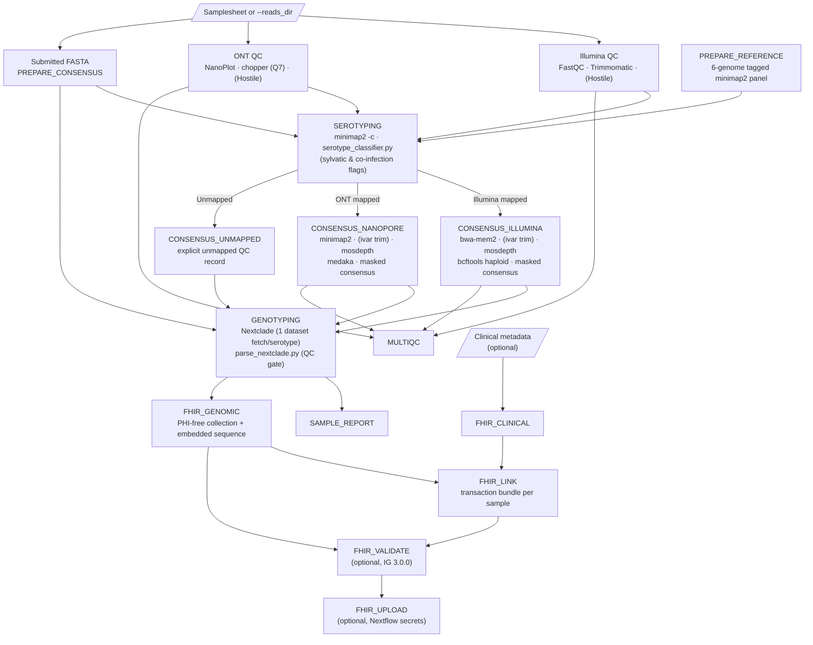

# Pipeline architecture

Every sample follows the branch for its sequencing platform (`illumina`, `ont`, or `fasta`), then
joins the shared serotyping, genotyping, reporting, and FHIR steps. Samples whose serotype cannot
be determined (`unknown`) are routed to `CONSENSUS_UNMAPPED` rather than falling back to a default
reference, so they still emit an explicit QC-failed genomic FHIR bundle. Clinical resource
generation, transaction linking, FHIR validation, and server upload run only when their
corresponding parameters are enabled.

